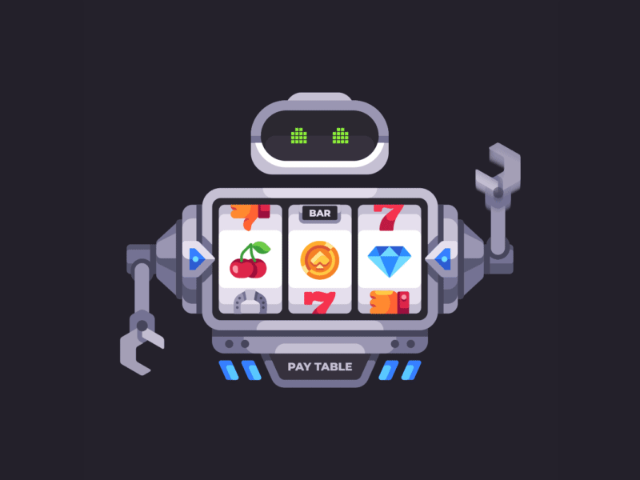
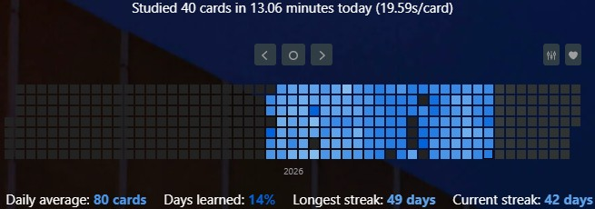

# ✩Welcome to My GitHub Profile!✩
Hi my name is Anselm and I'm a MD-PhD by trade breaking into software engineering to bring medical knowledge and technical innovation together🫀. I am passionate about open-source and always looking to learn, so feel free to reach out if you have a fitting challenge!

ﮩ٨ـﮩﮩ٨ـ♡ﮩ٨ـﮩﮩ٨ـ.ﮩ٨ـﮩﮩ٨ـ♡ﮩ٨ـﮩﮩ٨ـ.ﮩ٨ـﮩﮩ٨ـ♡ﮩ٨ـﮩﮩ٨ـ.ﮩ٨ـﮩﮩ٨ـ♡ﮩ٨ـﮩﮩ٨ـ.

## On LLMs and skill
As much as it bothers me, over the last months it became clear to me that LLMs are extremely powerful and will permanently change coding and research, above all how much of it is still done by hand.

But I also realized that skill atrophy is real: the tools were making me lazier and dumber. A tool that delivers near-instant, often very good results is tempting (like a slot machine promising fast wins, but losses - like skill atrophy - occur more often).

As researchers, though, our thinking abilities are essential. So instead of avoiding LLMs, I built the token-efficient [agentic-studying-loop](https://github.com/yungselm/agentic-studying-loop) workflow where they work *for* my learning instead of replacing it:

1. **Obsidian as the knowledge base** - everything I learn becomes a study note in my [Obsidian](https://obsidian.md/) vault, which doubles as my lookup when I'm stuck.
2. **A tool box to build Anki cards** - [Anki](https://apps.ankiweb.net/) is a spaced repetition program, which already got me through medschool. The agent is equiped with a toolbox to build a variety of card types, check them and compile them.
3. **A data-driven card standard** - From tens of thousands of my Staatsexamen reviews and thousands of reviews of my [rust-lang-kata](https://github.com/yungselm/rust-lang-kata) deck ("a basic vocabulary for Rust" plus the NeetCode 150) I derived a data-driven card standard.
4. **A CLAUDE.md in every project, linked to the vault** - Claude checks what I already know before explaining anything. Different modes let Claude act as a teacher, mentor or helper. Letting you control how much code you write.
5. **Knowledge from books to fill the gaps** - Additional tools allow the agent to build cards directly from books and slide, working in chunks saving tokens.

This way, code I'm fluent in gets automated, my effort goes into the challenging parts, and everything new ends up in spaced repetition instead of being forgotten.

The Anki-Progress will be posted here in irregular intervals (last updated 2026-11-08):

⫘⫘⫘⫘⫘⫘⫘⫘⫘⫘⫘⫘⫘⫘⫘⫘⫘⫘⫘
## Top Languages

## Technologies

## Current main research project

  
  

## Connect with me

	
	
	

