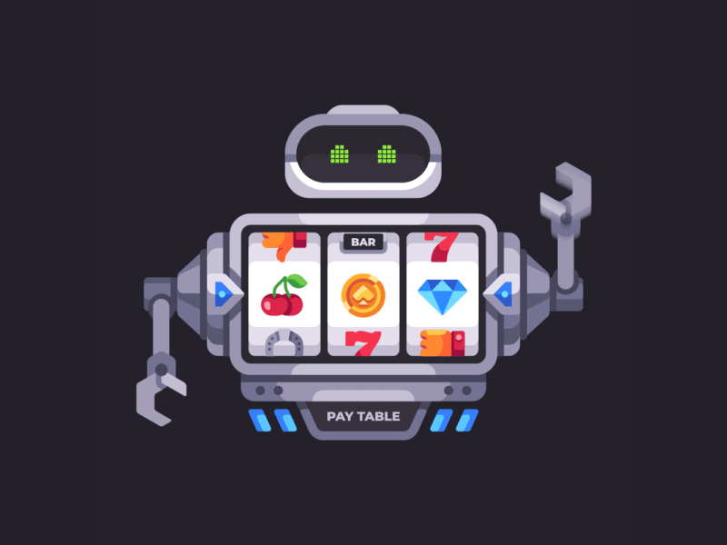
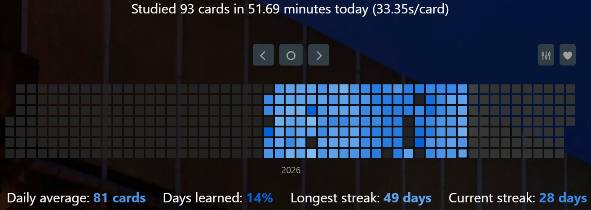

# ✩Welcome to My GitHub Profile!✩
Hi my name is Anselm and I'm a MD-PhD by trade breaking into software engineering to bring medical knowledge and technical innovation together🫀. I am passionate about open-source and always looking to learn, so feel free to reach out if you have a fitting challenge!

ﮩ٨ـﮩﮩ٨ـ♡ﮩ٨ـﮩﮩ٨ـ.ﮩ٨ـﮩﮩ٨ـ♡ﮩ٨ـﮩﮩ٨ـ.ﮩ٨ـﮩﮩ٨ـ♡ﮩ٨ـﮩﮩ٨ـ.ﮩ٨ـﮩﮩ٨ـ♡ﮩ٨ـﮩﮩ٨ـ.

## On LLMs and skill
As much as it bothers me, over the last months it became clear to me that LLMs are extremely powerful and will permanently change coding and research, above all how much of it is still done by hand.

But I also had to admit that skill atrophy is real: the tools were making me lazier and dumber. Thinking is hard and exhausting, and a tool that delivers near-instant, often very good results is tempting (like a slot machine promising fast wins, but losses occur more often).

As researchers, though, our thinking abilities are essential. So instead of avoiding LLMs, I built a workflow where they work *for* my learning instead of replacing it:

1. **Obsidian as the knowledge base** - everything I learn becomes a study note in my vault, which doubles as my lookup when I'm stuck.
2. **A data-driven card standard** - [Anki](https://apps.ankiweb.net/) already got me through medschool. From thousands of reviews of my [rust-lang-kata](https://github.com/yungselm/rust-lang-kata) deck ("a basic vocabulary for Rust" plus the NeetCode 150) I derived a card standard, e.g. code cards get harder with the characters you *type*, not the lines you read, so cards pre-fill the context and blank only the key line.
3. **A CLAUDE.md in every project, linked to the vault** - Claude checks what I already know before explaining anything. For a new topic: study note first, then I write the code, we confirm it together, and only then Claude writes Anki cards from it.

This way, code I'm fluent in gets automated, my effort goes into the challenging parts, and everything new ends up in spaced repetition instead of being forgotten, while avoiding asking the same thing over and over again.

The Anki-Progress will be posted here in irregular intervals (last updated 2026-10-25):

⫘⫘⫘⫘⫘⫘⫘⫘⫘⫘⫘⫘⫘⫘⫘⫘⫘⫘⫘
## Top Languages

## Technologies

## Current main research project

  
  

## Connect with me

	
	
	

